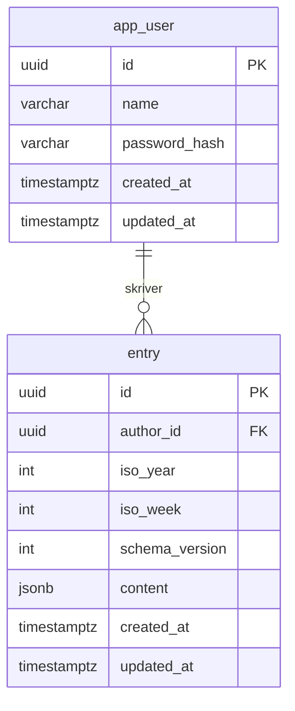

# Databas

PostgreSQL, schemat hanteras av Liquibase i
[`db.changelog-master.yaml`](../backend/src/main/resources/db/changelog/db.changelog-master.yaml).
Hibernate kör med `ddl-auto=validate`, så det är alltid Liquibase som ändrar schemat.

## Översikt



En användare kan ha många anteckningar, men högst en per vecka.

## `app_user`

En person som kan logga in.

| Kolumn          | Typ          | Betydelse                                     |
|-----------------|--------------|-----------------------------------------------|
| `id`            | uuid         | Primärnyckel, genereras av databasen.         |
| `name`          | varchar(255) | Användarens namn.                             |
| `password_hash` | varchar(255) | BCrypt-hash av lösenordet, aldrig klartext.   |
| `created_at`    | timestamptz  | När raden skapades.                           |
| `updated_at`    | timestamptz  | När raden senast ändrades.                    |

## `entry`

En veckoanteckning: en persons tankar om en viss vecka.

| Kolumn           | Typ         | Betydelse                                                                                   |
|------------------|-------------|---------------------------------------------------------------------------------------------|
| `id`             | uuid        | Primärnyckel, genereras av databasen.                                                       |
| `author_id`      | uuid        | Vem som skrivit anteckningen. Främmande nyckel till `app_user.id`.                          |
| `iso_year`       | int         | Veckoår enligt ISO 8601. Se [Veckor](#veckor).                                              |
| `iso_week`       | int         | Veckonummer enligt ISO 8601, 1–53.                                                          |
| `schema_version` | int         | Vilken version av formatet i `content` som raden är sparad med. Se [Versioner](#versioner). |
| `content`        | jsonb       | Själva formulärsvaren. Se [Innehållet i `content`](#innehållet-i-content).                  |
| `created_at`     | timestamptz | När anteckningen skapades.                                                                  |
| `updated_at`     | timestamptz | När anteckningen senast ändrades. Sätts av applikationen, inte av en trigger.               |

Regler som databasen upprätthåller:

- `uq_entry_author_week` – en användare kan bara ha en anteckning per (`iso_year`, `iso_week`).
- `fk_entry_author` – `author_id` måste peka på en befintlig användare, och en användare som har
  anteckningar kan inte tas bort.
- `ck_entry_iso_week` – `iso_week` måste ligga mellan 1 och 53.

### Veckor

`iso_year` är *veckoåret*, inte kalenderåret. De skiljer sig åt runt nyår: måndagen den
30 december 2024 tillhör vecka 1 år 2025 och sparas som `iso_year = 2025, iso_week = 1`.

I Java fås värdena med `IsoFields.WEEK_BASED_YEAR` och `IsoFields.WEEK_OF_WEEK_BASED_YEAR`,
inte med `getYear()`.

### Innehållet i `content`

Ett JSON-objekt där varje nyckel är ett fält-id och värdet är svaret:

```json
{
  "summary": "Lugn vecka, mycket jobb på torsdagen.",
  "next_week": "Middag hos mamma på lördag.",
  "meals": "Tacos, fisksoppa, rester"
}
```

`content` innehåller bara svaren. Vilka fält som finns, vilken typ av inmatningsfält de är
(`text`, `textarea`, `date`) och vilken etikett de har står i formulärdefinitionen i
frontend: [`fields.ts`](../frontend/src/lib/entry/fields.ts). Frontend ritar formuläret
utifrån den, och databasen känner inte till den.

Formulärfält kan läggas till och tas bort utan databasmigrering. För att gamla anteckningar ska
fortsätta gå att läsa gäller följande regler:

1. **Fält-id:n är stabila.** Nyckeln är ett internt id, inte etiketten som visas i gränssnittet.
   Etiketten får ändras fritt, men ett id får aldrig byta betydelse eller återanvändas till
   något annat.
2. **Fält avaktiveras, de raderas inte.** Ett fält som inte ska användas längre får
   `active: false` i definitionen. Då visas det inte i nya formulär, men gamla anteckningar som
   har ett svar på det kan fortfarande visas med rätt typ och etikett.
3. **Läs tolerant.** Ett fält som saknas i `content` betyder "inget svar".
4. **Värden sparas i fast format.** Alla svar är strängar, och datum sparas som ISO-datum
   (`2026-11-14`) oavsett hur de visas.
5. **Ny typ, nytt id.** Om ett fält byter typ så att svaret får ett annat format skapas ett nytt
   fält med nytt id, och det gamla avaktiveras.
6. **Höj `schema_version` vid brytande ändringar.** Se nedan.

### Versioner

`schema_version` börjar på 1 och sätts från `SCHEMA_VERSION` i `fields.ts`. Att lägga till eller ta bort ett fält kräver ingen ny version.
Versionen höjs bara när befintlig data måste tolkas annorlunda, till exempel om `meals` går
från en lista med strängar till en lista med objekt. Koden som läser `content` kan då välja
tolkning efter radens version.
