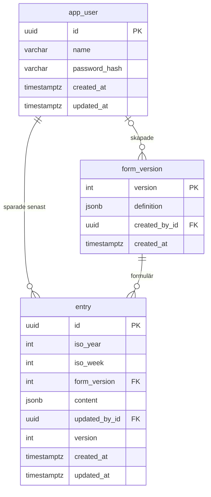

# Databas

PostgreSQL, schemat hanteras av Liquibase i
[`db.changelog-master.yaml`](../backend/src/main/resources/db/changelog/db.changelog-master.yaml).
Hibernate kör med `ddl-auto=validate`, så det är alltid Liquibase som ändrar schemat.

## Översikt



Det finns en gemensam anteckning per vecka, som alla användare läser och skriver i.

## `app_user`

En person som kan logga in.

| Kolumn          | Typ          | Betydelse                                     |
|-----------------|--------------|-----------------------------------------------|
| `id`            | uuid         | Primärnyckel, genereras av databasen.         |
| `name`          | varchar(255) | Användarens namn, så som det visas. Används som användarnamn vid inloggning, utan hänsyn till skiftläge, och är unikt oavsett skiftläge (`uq_app_user_name_lower`, ett unikt index på `lower(name)`). |
| `password_hash` | varchar(255) | BCrypt-hash av lösenordet, aldrig klartext.   |
| `created_at`    | timestamptz  | När raden skapades.                           |
| `updated_at`    | timestamptz  | När raden senast ändrades.                    |

## `spring_session` och `spring_session_attributes`

Inloggningssessionerna, se [inloggning.md](inloggning.md). Tabellerna ägs av Spring Session:
strukturen är kopierad från bibliotekets eget schema och ska inte ändras eller läsas av
applikationskoden. De har ingen främmande nyckel till `app_user`; kopplingen till användaren
är namnet i `spring_session.principal_name`.

## `entry`

En veckoanteckning: det gemensamma synk-mötets anteckningar för en viss vecka.

| Kolumn           | Typ         | Betydelse                                                                                   |
|------------------|-------------|---------------------------------------------------------------------------------------------|
| `id`             | uuid        | Primärnyckel, genereras av databasen.                                                       |
| `iso_year`       | int         | Veckoår enligt ISO 8601. Se [Veckor](#veckor).                                              |
| `iso_week`       | int         | Veckonummer enligt ISO 8601, 1–53.                                                          |
| `form_version`   | int         | Formulärsversionen som anteckningen sparades med. Främmande nyckel till `form_version.version`. |
| `content`        | jsonb       | Själva formulärsvaren. Se [Innehållet i `content`](#innehållet-i-content).                  |
| `updated_by_id`  | uuid        | Vem som sparade senast. Främmande nyckel till `app_user.id`.                                |
| `version`        | int         | Börjar på 0 och ökas vid varje sparning. Används för att upptäcka att två personer sparat samtidigt, se [api.md](api.md#spara). |
| `created_at`     | timestamptz | När anteckningen skapades.                                                                  |
| `updated_at`     | timestamptz | När anteckningen senast ändrades. Sätts av applikationen, inte av en trigger.               |

Regler som databasen upprätthåller:

- `uq_entry_week` – det finns bara en anteckning per (`iso_year`, `iso_week`).
- `fk_entry_updated_by` – `updated_by_id` måste peka på en befintlig användare, och en användare
  som senast sparat någon anteckning kan inte tas bort.
- `fk_entry_form_version` – formulärsversionen måste finnas.
- `ck_entry_iso_week` – `iso_week` måste ligga mellan 1 och 53.

### Veckor

`iso_year` är *veckoåret*, inte kalenderåret. De skiljer sig åt runt nyår: måndagen den
30 december 2024 tillhör vecka 1 år 2025 och sparas som `iso_year = 2025, iso_week = 1`.

I Java fås värdena med `IsoFields.WEEK_BASED_YEAR` och `IsoFields.WEEK_OF_WEEK_BASED_YEAR`,
inte med `getYear()`.

### Innehållet i `content`

Ett JSON-objekt där varje nyckel är ett fält-id i anteckningens formulärsversion och värdet
är svaret. Svarets format beror på fälttypen:

| Typ         | Svar                                            | Exempel                                   |
|-------------|-------------------------------------------------|-------------------------------------------|
| `text`      | sträng                                          | `"Lugn vecka"`                            |
| `textarea`  | sträng                                          | `"Tacos\nFisksoppa"`                      |
| `perPerson` | objekt från användar-id till sträng             | `{"8c69…": "Bra", "1f3a…": "Trött"}`      |
| `checklist` | lista med punkter                               | `[{"id": "b65d44353b", "text": "Panta", "done": false}]` |
| `weekdays`  | objekt från `mon`…`sun` till sträng             | `{"mon": "Köttfärssås", "fri": "Fajitas"}` |

Backend kontrollerar bara att nycklarna är fält i formuläret; formatet på svaren kontrolleras
av frontend ([`form.ts`](../frontend/src/lib/form/form.ts)), som läser tolerant:

- Ett fält som saknas betyder "inget svar". Tomma svar sparas inte.
- Ett svar i ett oväntat format visas som tomt.
- En checklista läser text som en punkt per rad. Därför kan ett fält byta typ från `textarea`
  till `checklist` och behålla sitt id (som `next_week` mellan version 1 och 2).

## `form_version`

Veckoformuläret. Varje ändring i formuläret, gjord i appen med "Ändra formuläret", sparas som
en ny version; en befintlig version ändras aldrig. En anteckning visas alltid med versionen den
sparades med, så gamla veckor ser ut som de gjorde. En vecka utan anteckning får den senaste
versionen.

| Kolumn          | Typ         | Betydelse                                                         |
|-----------------|-------------|-------------------------------------------------------------------|
| `version`       | int         | Primärnyckel, 1, 2, 3, … Nästa version är den högsta plus ett.    |
| `definition`    | jsonb       | Avsnitten och fälten, se nedan.                                   |
| `created_by_id` | uuid        | Vem som skapade versionen. Null för versionerna som följde med appen (1 och 2). |
| `created_at`    | timestamptz | När versionen skapades.                                           |

```json
{
  "sections": [
    {
      "title": "Summering",
      "fields": [
        { "id": "mood", "type": "perPerson", "label": "Hur mår du?" },
        { "id": "last_plan", "type": "checklist", "label": "Förra veckans plan", "carryFrom": "next_week" }
      ]
    },
    { "title": "Nästa vecka", "fields": [{ "id": "next_week", "type": "checklist", "label": "" }] }
  ]
}
```

- `id` är nyckeln i `content`. Fält som skapas i appen får ett slumpat id (`f` och tio tecken),
  så ett borttaget fälts id återanvänds aldrig. Id:t ändras inte när frågan byter text.
- `label` är frågan. Den kan vara tom; då visas bara avsnittets rubrik.
- `carryFrom` finns bara på checklistor. När en vecka utan anteckning öppnas fylls fältet i med
  punkterna från fältet `carryFrom` i den senaste tidigare anteckningen, avbockade om de var
  avbockade där. Det förifyllda sparas först när någon sparar veckan. I appen finns också en
  knapp som flyttar de punkter som inte är avbockade till fältet `carryFrom` i samma vecka.

Version 1 är formuläret från innan formulären flyttade till databasen. Version 2 bygger på det
första synk-mötet. Båda skapas av Liquibase (changeset 007).
